<p align="center">
  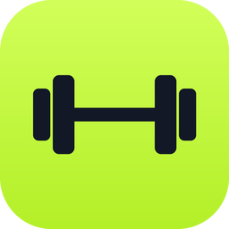
</p>

<h1 align="center">GYM Paper</h1>

<p align="center">
  A calm, free workout & nutrition tracker for iPhone and Apple Watch.<br>
  Designed and built end to end by a product designer working with AI. Free and open source.
</p>

<p align="center">
  <a href="https://apps.apple.com/app/id6826874026">App Store</a> ·
  <a href="https://gympaper.vercel.app">Website</a> ·
  <a href="FIGMA_COMMUNITY_URL">Figma file</a> ·
  <a href="DESIGN.md">Design doc</a>
</p>

<p align="center">
  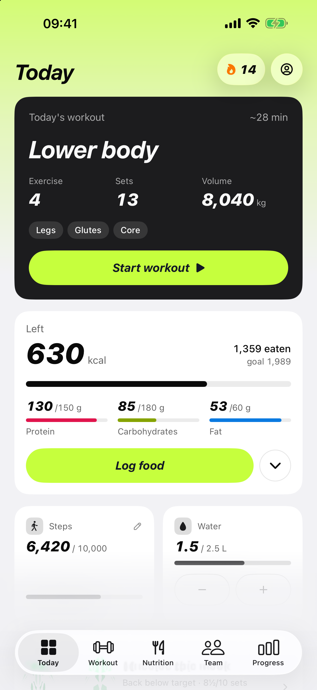
  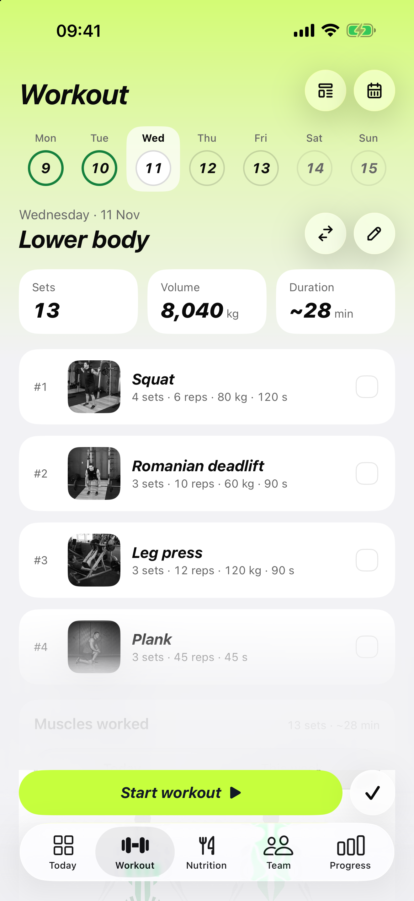
  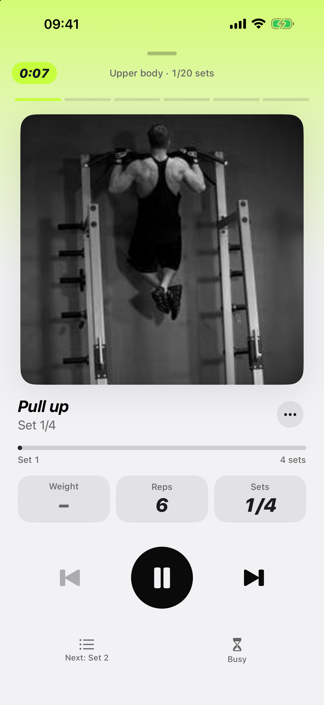
  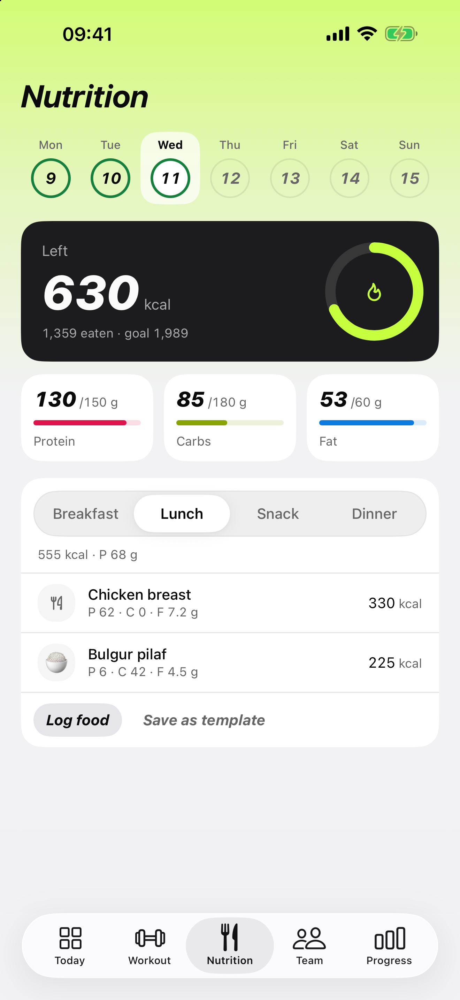
  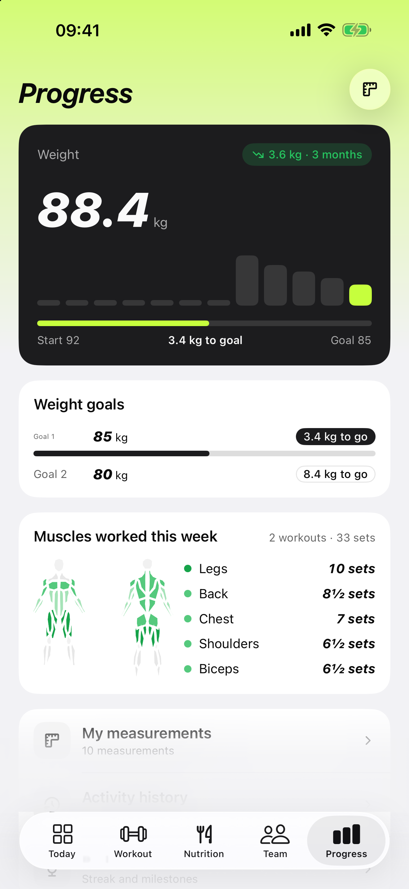
</p>
<p align="center">
  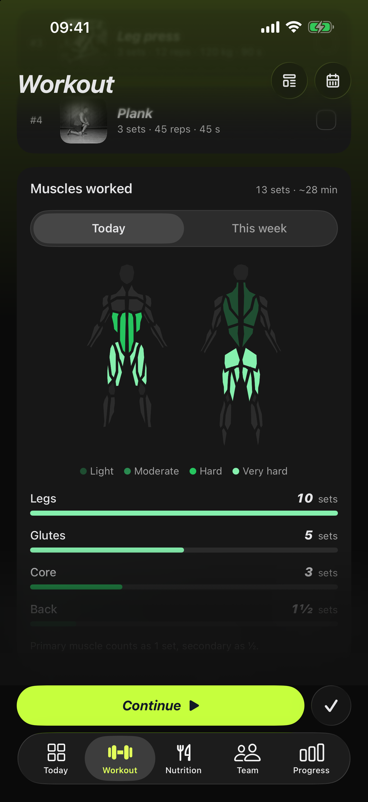
  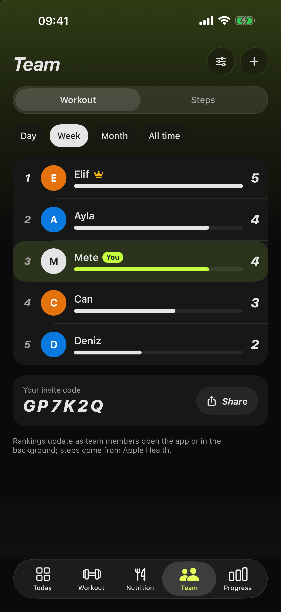
  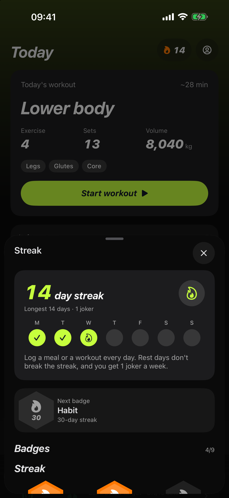
  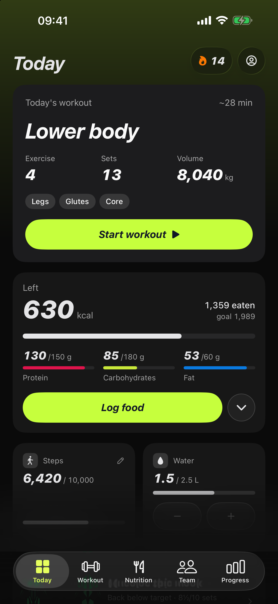
  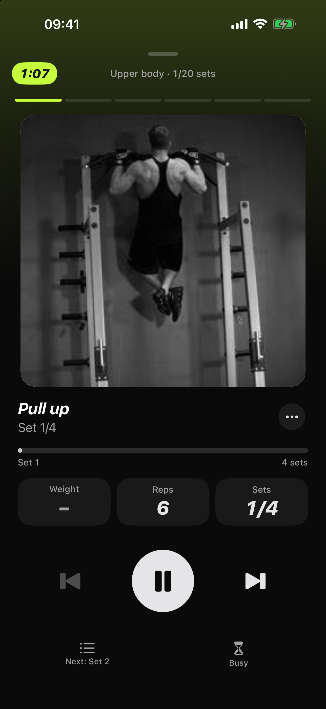
</p>
<p align="center">
  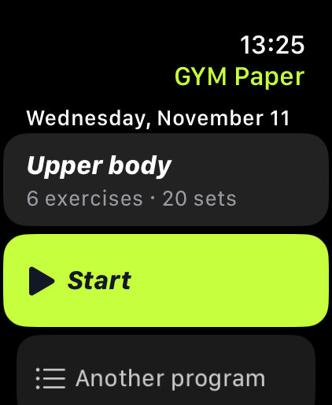
  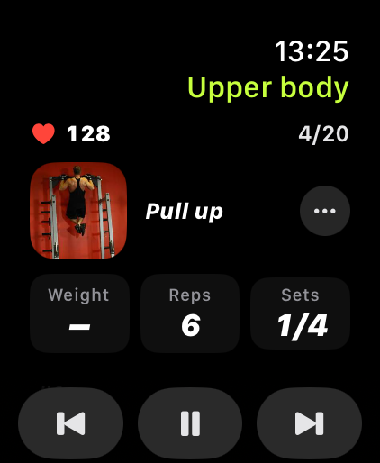
  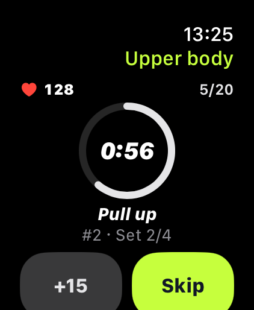
  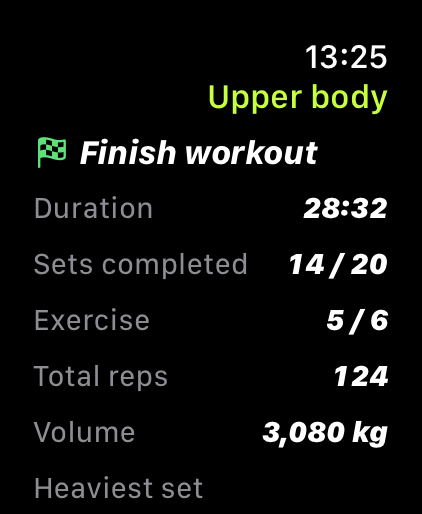
</p>

## Why this exists

I'm a product designer. I wanted a training app that does the few things I need, beautifully, with no
account, no ads and no subscription. So I designed it in Figma and built it with AI: every screen, the
SwiftUI code, the Apple Watch app, the widgets, the landing page and the App Store assets. It passed App
Review and is live on the App Store.

This repo is the whole thing, open. Use it to learn, fork it, ship your own version, or send a PR.

## What it does

- **Today** — today's workout, calories left, steps and water, plus a weekly muscle card and a check-in.
- **Workout** — your weekly program, a full-screen player with sets, reps, weight, rest timer and
  supersets; a muscle map for today and this week, and a weight suggestion when you're ready to go up.
- **Nutrition** — log what you eat (no meal plans), calories and macros, barcode scanning, recipes,
  saved meals, intermittent fasting with an eating window.
- **Progress** — weight trend and goals, weekly sets per muscle, measurements, activity history.
- **Team** — an optional steps and workouts leaderboard with your partner and friends.
- **Streaks & badges** — a workout, a meal or your step goal keeps the streak; rest days don't break it.
- **Apple Watch** — run the workout from your wrist with haptics on the last 3 seconds of rest,
  live sync with iPhone, and complications (today's workout, calories left, fasting).
- **Widgets & Live Activity** — calories left, today's workout, rings, rest countdown on the Lock Screen.
- **Apple Health** — steps, active energy, weight in; workouts out.
- **Share a workout** with a QR code or a link; your friend previews it before importing.
- **Private by default** — data stays on device and in your own iCloud. Turkish and English.

## Tech

| | |
|---|---|
| UI | SwiftUI, iOS 18+ / watchOS 11+, hybrid "liquid glass" design system (`GymPaper/Design`) |
| Data | SwiftData + CloudKit private database, versioned schema & migrations |
| Core logic | `GymPaperKit` Swift package — calorie engine, plans, fasting, food search, sharing — with unit tests |
| Platforms | iPhone, Apple Watch, WidgetKit, ActivityKit (Live Activities), App Intents, HealthKit |
| Project | [XcodeGen](https://github.com/yonaskolb/XcodeGen) (`ios/project.yml`) |
| Website | Static HTML/CSS in `site/` (Vercel) |


```
ios/
  GymPaper/             iPhone app (Views, Design system, Logic, Services, Resources)
  GymPaperKit/          Pure Swift package + tests (no UI)
  GymPaperWatch/        Apple Watch app
  GymPaperWatchWidgets/ Watch complications
  GymPaperWidgets/      iPhone widgets + Live Activity
  Shared/            Code shared between app and extensions
  Config/            Build settings (bundle id, team, optional backend)
site/                Landing page
```

## Run it

Requirements: macOS with Xcode 26+ and [XcodeGen](https://github.com/yonaskolb/XcodeGen).

```bash
brew install xcodegen
git clone https://github.com/designermetehan-coder/gym-paper.git
cd gym-paper/ios
cp Config/Secrets.example.xcconfig Config/Secrets.xcconfig   # your bundle id + Apple team id
xcodegen generate
open GymPaper.xcodeproj
```

Run the **GymPaper** scheme on a simulator. Launch arguments make demos easy:

| Argument | Effect |
|---|---|
| `-demo` | Separate demo database with sample data (your data is untouched) |
| `-demo -empty` | Empty states |
| `-demo -onboarding -onbStep 2` | A specific onboarding step |
| `-demo -tab workout` | Open a tab directly |
| `-demo -session` | Open the workout player |

To run on a device you need your own Apple Developer team, plus App Group, iCloud (CloudKit) and
HealthKit capabilities for your bundle id. iCloud sync and HealthKit are optional at runtime.

### Optional backend

Food search works offline (built-in list) and online through Open Food Facts out of the box.
The FatSecret proxy and the social step leaderboard need your own Supabase project; put the host and
publishable key in `ios/Config/Secrets.xcconfig`. With no values set, those features stay off.
Server code lives in [`supabase/`](supabase): `social.sql` (team leaderboard, RPC-only, RLS on),
`food_requests.sql` and the `functions/fatsecret` proxy (set `FATSECRET_CLIENT_ID` / `FATSECRET_CLIENT_SECRET` as function secrets).

## Design

- **Figma Community file** — every iPhone screen and state, Apple Watch, widgets, complications,
  the landing page and the design system: [FIGMA_COMMUNITY_URL](FIGMA_COMMUNITY_URL)
- **Design doc** — problem, principles, decisions and trade-offs: [DESIGN.md](DESIGN.md)

## Not included

- **MoveKit 3D exercise animations** — licensed for the App Store build only. The app falls back to free
  (public-domain) exercise photos or a silhouette.
- **The full built-in food list** — the App Store build ships 1,800+ curated foods; this repo ships a
  ~300-item sample. Everything else comes from Open Food Facts online.
- **Design research screenshots** — third-party app screens used for benchmarking are not in the Figma
  Community file.

See [THIRD_PARTY_NOTICES.md](THIRD_PARTY_NOTICES.md).

## Contributing & security

PRs are welcome — read [CONTRIBUTING.md](CONTRIBUTING.md). Found a vulnerability? See [SECURITY.md](SECURITY.md).

## License

[MIT](LICENSE) © 2026 Metehan Kaya. "GYM Paper" name and app icon are not covered by the license;
please use your own name and icon if you publish a fork.
