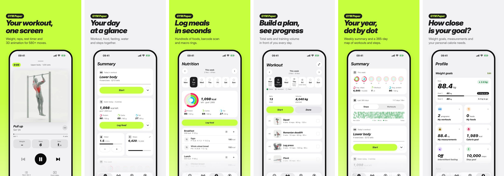

<div align="center">

# GYM Paper

**Antrenman, beslenme ve aralıklı oruç tek uygulamada. Ücretsiz ve reklamsız.**
iOS, Apple Watch, widget'lar ve web PWA. Verilerin cihazında kalır.

[App Store](https://apps.apple.com/app/id6826874026) · [Web sitesi](https://gympaper.vercel.app) · [Figma dosyası](FIGMA_COMMUNITY_URL) · [English](README.md)



</div>

## Özellikler

| Alan | Ne yapar |
|---|---|
| **Antrenman** | Program ve haftalık plan; set, tekrar, kilo ve dinlenme sayacıyla tam ekran oynatıcı; süper set; kişisel rekorlar |
| **Beslenme** | Kalori ve makro halkalı öğün kaydı, Türkçe serbest metinle giriş, barkod (Open Food Facts), favoriler ve tarifler |
| **Oruç** | Sabit saatli aralıklı oruç, evreler, Live Activity ve kilit ekranı sayacı |
| **Özet** | Günün özeti, haftalık özet ve 365 günlük aktivite haritası |
| **Apple Watch** | iPhone ile eşitlenen bağımsız antrenman oynatıcısı, HealthKit antrenman oturumu, komplikasyonlar |
| **Widget'lar** | Kalan kalori, adım, su, hafta ve antrenman |
| **Gizlilik** | Hesap, reklam, takip yok. Veriler cihazda ve kendi iCloud'unda; Apple Sağlık isteğe bağlı |

## Hızlı başlangıç

**iOS** (Xcode 26+, XcodeGen):

```sh
cd apps/ios
make bootstrap && make open
```

**Web** (Node 20+):

```sh
cd apps/web
npm ci && npm run dev
```

Ayrıntılar için [docs/](docs) klasörüne bak. Repo yapısı, kurulum ve katkı kuralları [README.md](README.md) ve [CONTRIBUTING.md](CONTRIBUTING.md) içinde.

> Proje **Ballı** kod adıyla başladı; hedef, modül ve klasör adlarında bu adı görürsün.

## Lisans

Kod [MIT](LICENSE) lisanslıdır. Figma dosyası Figma Community'de [CC BY 4.0](https://creativecommons.org/licenses/by/4.0/) ile paylaşılır. Üçüncü taraf veri, yazı tipi ve görseller kendi lisanslarıyla [THIRD_PARTY_NOTICES.md](THIRD_PARTY_NOTICES.md) içinde listelenir. App Store sürümündeki 3D hareket animasyonları [MoveKit](https://movekit.com) lisanslıdır ve bu depoda **yer almaz**.

---

Tasarlayan ve geliştiren: [Metehan Kaya](https://designermete.com)
